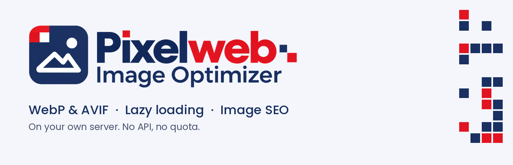
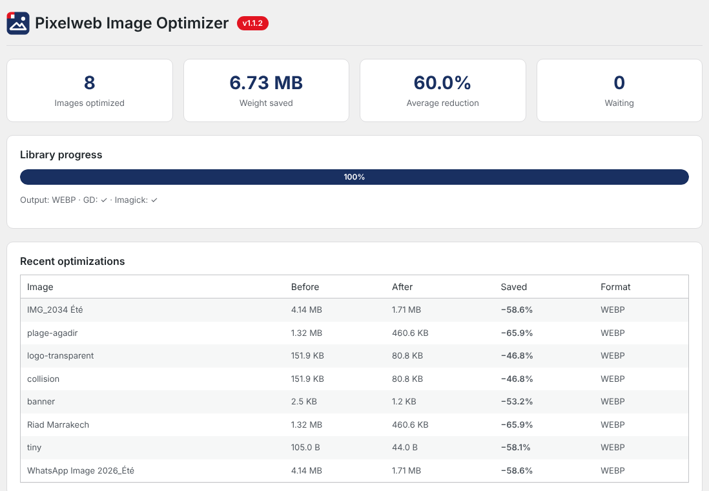
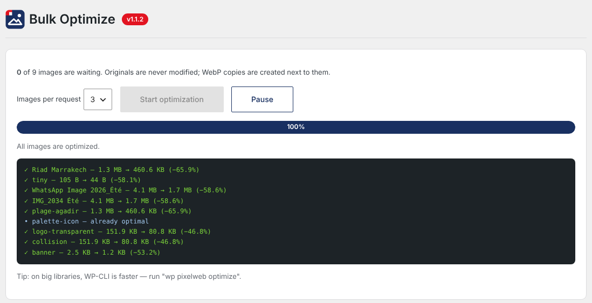
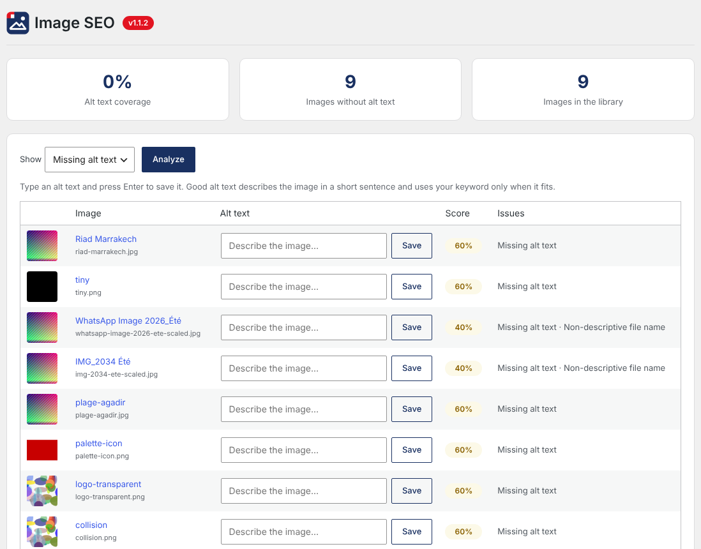
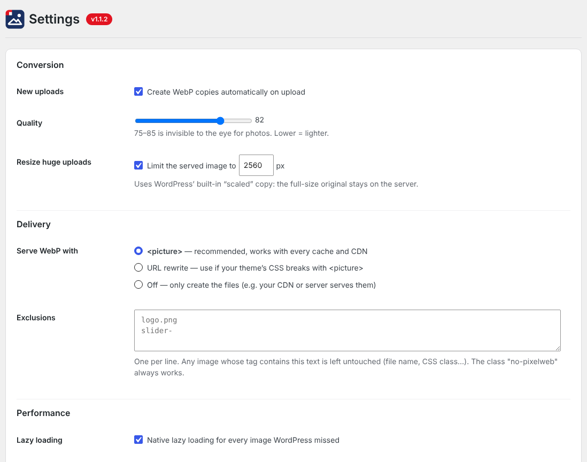

# Pixelweb Image Optimizer

[](https://wordpress.org/plugins/pixelweb-image-optimizer/)
[](https://wordpress.org/plugins/pixelweb-image-optimizer/)
[](https://www.gnu.org/licenses/gpl-2.0.html)
[](https://www.php.net/)

**WebP conversion on your own server, cache-safe delivery, LCP-friendly lazy loading and an image SEO checker. No external API, no quotas.**

Published on the official WordPress Plugin Directory → [wordpress.org/plugins/pixelweb-image-optimizer](https://wordpress.org/plugins/pixelweb-image-optimizer/)



---

## Why this plugin exists

Most WordPress image optimizers send your files to a paid cloud service with monthly credits. This one converts images **on your own server**, using the GD or Imagick library WordPress already relies on. No account, no API key, no quota, no limit on the number of images.

It also merges three things that are usually three separate plugins — conversion, lazy loading and image SEO — into one dashboard, because agencies that hand sites over to clients need all three.

## Features

### Conversion
- Automatic WebP copies of every new upload and every thumbnail size
- Bulk optimization of an existing media library, with no quota
- Originals are never modified; WebP files live in their own folder (`uploads/pixelweb-image-optimizer/`) mirroring the media library structure, so `photo.jpg` and `photo.png` can never overwrite each other
- A WebP heavier than its original is discarded automatically

### Delivery
- **`<picture>` tags (default)** — the browser picks the format, so a cached page is correct for every visitor. Safe with page caches, CDNs and Cloudflare.
- **URL rewrite mode** for themes whose CSS does not cope with `<picture>`
- Works with blocks, classic content, featured images, widgets, block theme templates and WooCommerce galleries
- Per-image exclusion by file name or CSS class

### Core Web Vitals
- Native lazy loading (no JavaScript) for the images WordPress misses
- **LCP protection**: the first images of a page are never lazy-loaded
- `decoding="async"` on every image

### Image SEO
- SEO score for every image in the media library
- Inline alt text editor: type, press Enter, next image
- Detects missing or weak alt text, non-descriptive file names (`IMG_`, `DSC`, `WhatsApp Image`…), heavy and oversized files
- SEO-friendly file names on upload — `Photo Été_2024.JPG` becomes `photo-ete-2024.jpg`

## Screenshots

| Dashboard | Bulk optimization |
|---|---|
|  |  |

| Image SEO | Settings |
|---|---|
|  |  |

## Architecture

The plugin follows a single-responsibility structure. The main file wires a singleton that boots each component on `plugins_loaded`, injecting the shared converter instance where it is needed.

```
pixelweb-image-optimizer.php     Bootstrap, constants, DB migrations, WP-CLI registration
├── includes/
│   ├── class-pixelweb-converter.php   WebP encoding (GD / Imagick), file layout, status tracking
│   ├── class-pixelweb-delivery.php    <picture> markup and URL rewrite output filters
│   ├── class-pixelweb-lazyload.php    Native lazy loading with LCP protection
│   ├── class-pixelweb-seo.php         Image SEO scoring and filename sanitisation
│   ├── class-pixelweb-settings.php    Options API, defaults, validation
│   ├── class-pixelweb-stats.php       Custom table, savings aggregation
│   ├── class-pixelweb-ajax.php        Admin AJAX endpoints (nonce-checked)
│   └── class-pixelweb-cli.php         WP-CLI command handlers
├── admin/
│   └── class-pixelweb-admin.php       Settings pages, media library integration
└── languages/                          Translation template (.pot)
```

**Design notes**

- Versioned database migrations (`PIXELWEB_DB_VERSION`) with upgrade routines that run on version mismatch
- Extensible by design: components boot on `plugins_loaded` priority 5 and fire a `pixelweb_loaded` action so add-ons can hook in
- Fully internationalised, with a generated `.pot`
- Clean uninstall via `uninstall.php`

## For developers

### WP-CLI

```bash
wp pixelweb optimize    # Convert the media library
wp pixelweb status      # Show conversion status and savings
wp pixelweb clean       # Remove generated WebP files
```

### Filters

| Filter | Purpose |
|---|---|
| `pixelweb_quality` | WebP encoding quality (default 82) |
| `pixelweb_exclusions` | Images to never convert |
| `pixelweb_delivery_filters` | Which output filters delivery hooks into |
| `pixelweb_picture_sources` | Modify the `<source>` elements emitted |
| `pixelweb_loaded` | Action fired once every component is booted |

## Requirements

- WordPress 6.2 or later
- PHP 7.4 or later
- GD or Imagick compiled with WebP support
- Write access to the uploads folder

## Installation

From the WordPress admin: **Plugins → Add New**, search for *Pixelweb Image Optimizer*, install and activate.

Manually: download from [wordpress.org](https://wordpress.org/plugins/pixelweb-image-optimizer/), unzip into `wp-content/plugins/`, then activate.

Then open **Pixelweb → Settings**, keep the default quality, and run **Pixelweb → Bulk Optimize** on your existing library.

## License

GPL-2.0-or-later. See [LICENSE](LICENSE).

## Author

Built and maintained by [Pixelweb](https://pixelweb.ma) — Casablanca, Morocco.
